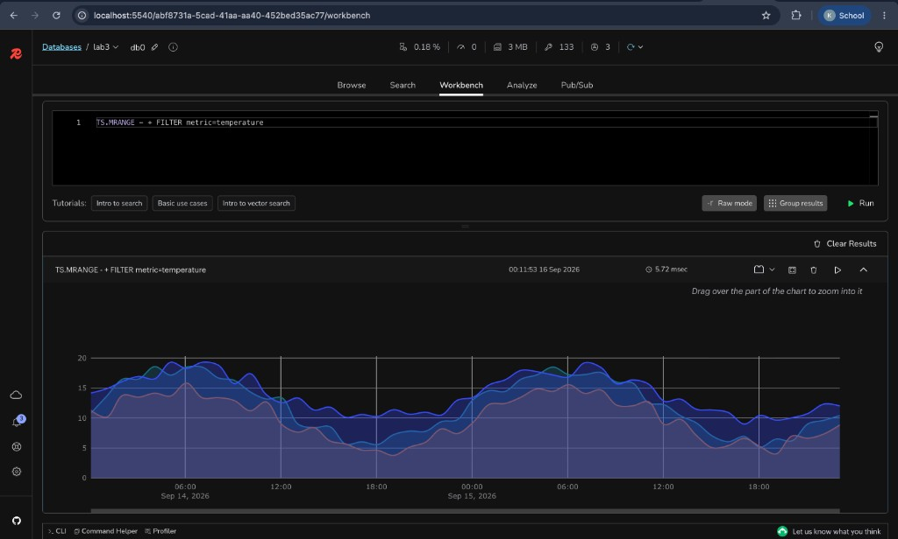

## Лабораторна робота №3

### RedisInsight, часові ряди та аналіз даних

#### Мета

Навчитися:
- підключатися до Redis через RedisInsight і Python;
- працювати з типами даних Hash, Stream та TimeSeries;
- аналізувати дані та оцінювати виконання запитів.

Виконання цієї лабораторної роботи підрозуміває, що попередні лабораторні виконані та базові типи даних Redis (рядки, хеші, списки, множини) вже знайомі.

### Необхідне середовище

- **Redis Stack** з модулем RedisTimeSeries;
- **RedisInsight** (desktop-додаток);
- **Python 3**, віртуальне середовище (`venv`) та бібліотека `redis`.

> ⚠️ Звичайний Redis (redis-server) **не містить** тип даних TimeSeries. Для команд `TS.CREATE`, `TS.ADD`, `TS.MRANGE` і графіка в Workbench потрібен саме Redis Stack.


#### 0.1 Встановлення Redis Stack

Найпростіший спосіб — Docker:

```console
docker run -d --name redis-stack -p 6379:6379 redis/redis-stack-server:latest
```

Альтернатива без Docker — встановлення Redis Stack напряму: [офіційна інструкція](https://redis.io/docs/latest/operate/oss_and_stack/install/install-stack/).

#### 0.2 Встановлення RedisInsight

Найпростіший спосіб — запустити веб-версію RedisInsight у Docker з [офіційного образу](https://hub.docker.com/r/redis/redisinsight):

```console
docker run -d --name redisinsight -p 5540:5540 redis/redisinsight:latest
```

Після запуску відкрийте у браузері [http://localhost:5540](http://localhost:5540) — інтерфейс ідентичний desktop-версії.

Альтернатива — завантажити RedisInsight з [офіційного сайту](https://redis.io/insight/) та встановити як звичайний desktop-застосунок.

Після запуску додайте підключення до бази:

- Host: `localhost` (для desktop-версії) або `host.docker.internal` (якщо RedisInsight запущений у Docker, а Redis Stack — в іншому контейнері);
- Port: `6379`.


#### 0.3 Встановлення бібліотеки Python

Пакети ставте у **віртуальне середовище** (`venv`), а не в системний Python. Залежності лабораторної тоді не змішуються з іншими проєктами. У ході роботи знадобиться не лише `redis` — нові бібліотеки ставте в те саме середовище.

У каталозі зі скриптами створіть середовище і активуйте його:

```console
python3 -m venv .venv
```

```console
# Linux / macOS / WSL
source .venv/bin/activate

# Windows (cmd / PowerShell)
.venv\Scripts\activate
```

У запрошенні термінала має з’явитись `(.venv)`. Поки середовище активне, `pip` і `python` вказують на нього.

Встановіть клієнт Redis і будь-які інші пакети, які знадобляться далі:

```console
pip install redis
```

Переглянути встановлені пакети: `pip list`. Вийти зі середовища: `deactivate`.

#### 0.4 Перевірка середовища

Перед початком роботи перевірте підключення:

```console
redis-cli PING
redis-cli MODULE LIST
```

Якщо Redis Stack запущений у Docker, `redis-cli` на хості може бути відсутній — виконуйте команди всередині контейнера:

```console
docker exec -it redis-stack redis-cli PING
docker exec -it redis-stack redis-cli MODULE LIST
```

`PING` має повернути `PONG`, а у виводі `MODULE LIST` має бути модуль `timeseries`. Якщо модуля немає — ви підключились до звичайного Redis, а не до Redis Stack.

### Індивідуальний варіант: четверте місто

Кожен студент працює з **чотирма** містами: Київ, Львів, Одеса — спільні для всіх, а четверте — **індивідуальне**, за вашим номером у списку групи.

Своє місто знайдіть у таблиці варіантів: **[variants.md](variants.md)**. Там само — правила вибору (якщо номер більший за 35), транслітерація назв для ключів Redis та приклад.

Далі в тексті `<misto>` означає назву вашого індивідуального міста з колонки «Назва для ключів», наприклад `weather:vinnytsia:temperature`.

Індивідуальне місто має з'явитись **у всіх** структурах даних лабораторної: Hash, TimeSeries, Stream і на фінальному графіку у Workbench. Це перевіряється під час демонстрації.

### Хід Роботи


#### 1. Підключення та базові дані

Через Python (redis-py) підключіться до Redis:

```python
import redis

r = redis.Redis(host="localhost", port=6379, decode_responses=True)
print(r.ping())
```


##### 🎯 Завдання:

1. Створіть з Python чотири Hash-ключі з поточним станом погоди у містах — три спільні та ваше індивідуальне місто:

```console
HSET city:kyiv temperature 10 humidity 80
HSET city:lviv temperature 12 humidity 75
HSET city:odessa temperature 15 humidity 70
HSET city:<misto> temperature <...> humidity <...>
```

   Значення для свого міста оберіть самостійно (правдоподібні).
2. У RedisInsight відкрийте вкладку **Browser**, знайдіть ключі за шаблоном `city:`* та перегляньте їхній тип і поля. Має бути **чотири** ключі. Зробіть скриншот для звіту.

#### 2. Часові ряди температури

RedisTimeSeries — тип даних для зберігання вимірів у часі: кожен запис це пара (timestamp, value). Мітки (LABELS) дозволяють фільтрувати ряди у запитах `TS.MRANGE`.

##### 🎯 Завдання:

1. Створіть чотири часові ряди:

```console
TS.CREATE weather:kyiv:temperature LABELS city kyiv metric temperature unit C
TS.CREATE weather:lviv:temperature LABELS city lviv metric temperature unit C
TS.CREATE weather:odessa:temperature LABELS city odessa metric temperature unit C
TS.CREATE weather:<misto>:temperature LABELS city <misto> metric temperature unit C
```

1. Напишіть Python-скрипт, який згенерує **щонайменше 48 погодинних значень** температури для кожного міста та запише їх через `TS.ADD`. Дані повинні містити різні значення, наприклад синусоїдальну добову зміну з випадковим шумом:

```python
import math, random, time

now_ms = int(time.time() * 1000)
hour_ms = 3600 * 1000

for i in range(48):
    ts = now_ms - (48 - i) * hour_ms
    value = 12 + 6 * math.sin(i / 24 * 2 * math.pi) + random.uniform(-1.5, 1.5)
    r.execute_command("TS.ADD", "weather:kyiv:temperature", ts, round(value, 2))
```

Для інших міст (включно з індивідуальним) змініть базову температуру та/або амплітуду, щоб ряди відрізнялись.

> ⚠️ Скрипт не можна запустити двічі «як є»: повторний `TS.CREATE` існуючого ключа поверне помилку `TSDB: key already exists`, а повторний `TS.ADD` з тим самим timestamp — помилку duplicate policy. Для налагодження перед повторним запуском видаліть ряди (`DEL weather:kyiv:temperature weather:lviv:temperature weather:odessa:temperature weather:<misto>:temperature`) або створюйте їх з опцією `TS.CREATE ... DUPLICATE_POLICY LAST`.


#### 3. Потік журналу трафіку (Stream)

Redis Stream — журнал подій, у який записи додаються послідовно командою `XADD`. Приклад однієї події:

```console
XADD traffic:events * city kyiv bytes 2450 status 200
```


##### 🎯 Завдання:

1. Згенеруйте з Python **щонайменше 1000 випадкових подій** вебтрафіку та збережіть їх у Stream `traffic:events`. Кожна подія повинна містити:
  - час події;
  - місто (випадково з ваших **чотирьох** міст, включно з індивідуальним);
  - кількість переданих байтів;
  - HTTP-статус (наприклад 200, 301, 404, 500).
2. Перевірте кількість записів командою `XLEN traffic:events`.


#### 4. Статистичний аналіз


##### 🎯 Завдання:

1. У Python прочитайте всі значення поля `bytes` зі Stream `traffic:events` (команда `XRANGE traffic:events - +`) та обчисліть:
  - кількість подій;
  - середнє значення;
  - медіану;
  - моду або всі моди;
  - мінімум і максимум.
   Скористайтесь модулем `statistics` зі стандартної бібліотеки Python.
2. Збережіть підсумок у Hash `analysis:traffic`:

```console
HSET analysis:traffic count 500 mean 2519.4 median 2480 mode "2450,3120" min 100 max 4999
```

   Зверніть увагу: при випадкових даних мод може бути декілька (`statistics.multimode` повертає список) — збережіть їх усі, наприклад через кому.
3. Додайте до звіту короткий висновок про розподіл трафіку (наскільки середнє відрізняється від медіани, чи є викиди).

#### 5. Робота у RedisInsight Workbench

Workbench — вкладка RedisInsight для виконання команд з розширеною візуалізацією результатів. Для команд RedisTimeSeries (зокрема `TS.RANGE` та `TS.MRANGE`) RedisInsight має вбудований плагін візуалізації, який відображає результат у вигляді графіка (**Chart**) замість «сирої» відповіді сервера.

##### 🎯 Завдання:

1. У Workbench виконайте запит:

```console
TS.MRANGE - + FILTER metric=temperature
```

`TS.MRANGE` повертає всі часові ряди, у яких мітки відповідають фільтру. Ми фільтруємо за міткою `metric=temperature`, яку задали при `TS.CREATE`, тому у результат потраплять усі чотири ряди одразу — без перелічування ключів вручну.

1. Результат відобразиться у режимі **Chart** (якщо відкрився табличний/текстовий вид — перемкніть його перемикачем у картці результату). На графіку мають відображатися **чотири** часові ряди: Київ, Львів, Одеса та ваше індивідуальне місто.

Очікуваний результат (на прикладі трьох спільних міст; у вашому випадку ліній буде чотири):



Як читати графік:

- **Вісь X** — час (timestamp кожного запису `TS.ADD`); у нашому випадку це 48 годин погодинних вимірів.
- **Вісь Y** — значення температури у °C.
- Кожен колір — окремий часовий ряд (ключ `weather:{місто}:temperature`); легенда з назвами ключів знаходиться під графіком.
- Хвилеподібна форма — це синусоїдальна добова зміна температури з вашого скрипта: піки припадають на «день», спади — на «ніч», а нерівності кривої — випадковий шум.
- Виділіть мишею ділянку графіка, щоб **збільшити** її (zoom); під графіком є перемикачі відображення: Line/Points, Fill, Staircase.

> 📊 Це **обов'язкова демонстрація** наприкінці лабораторної: студент показує викладачу графік у Workbench, пояснює осі, називає місто з найвищою та найнижчою температурою у вибраному інтервалі. Викладач звіряє четвертий ряд на графіку з номером студента у списку групи — місто має відповідати [таблиці індивідуальних варіантів](variants.md).


#### 6. Аналіз запитів і продуктивності


##### 🎯 Завдання:

1. У Workbench виконайте та порівняйте:

```console
KEYS city:*
SCAN 0 MATCH city:* COUNT 100
INFO commandstats
SLOWLOG GET 10
```

1. У звіті поясніть:
  - чому `KEYS` небажано використовувати на великій production-базі;
  - чому `SCAN` безпечніший для поступового обходу ключів;
  - які команди виконувалися найчастіше і чому саме вони (дивіться `INFO commandstats`: поле `calls` — кількість викликів, `usec_per_call` — середній час; );
  - чи потрапили якісь команди до Slow Log і чому він, найімовірніше, порожній (дивіться `SLOWLOG GET 10`: туди записуються команди, повільніші за поріг `slowlog-log-slower-than`, за замовчуванням 10 мс);
  - як структура даних впливає на доступ: Hash для поточного стану міста, TimeSeries для вимірів у часі, Stream для послідовності подій.


### Що здати

- Python-скрипт;
- короткий звіт із командами та результатами статистики (на початку звіту вкажіть свій номер у списку групи та індивідуальне місто);
- скриншот вкладки Browser з чотирма ключами `city:*`;
- скриншот або жива демонстрація графіка в RedisInsight Workbench з чотирма рядами;
- висновок щодо `KEYS` і `SCAN`.


##### Вимоги до оформлення

Звіт лабораторної роботи повинен містити текстову частину завдання та скріншоти з командами та відповідним виводом. В кінці звіту обов'язково повинен бути висновок.

##### Джерела

- [Міста України (за алфавітом) — Вікіпедія](https://uk.wikipedia.org/wiki/%D0%9C%D1%96%D1%81%D1%82%D0%B0_%D0%A3%D0%BA%D1%80%D0%B0%D1%97%D0%BD%D0%B8_(%D0%B7%D0%B0_%D0%B0%D0%BB%D1%84%D0%B0%D0%B2%D1%96%D1%82%D0%BE%D0%BC))
- [RedisInsight repository](https://github.com/redis/RedisInsight)
- [Підтримка Chart для TS.MRANGE](https://github.com/redis/RedisInsight/blob/main/redisinsight/ui/src/packages/redistimeseries-app/package.json)
- [Документація RedisTimeSeries](https://redis.io/docs/latest/develop/data-types/timeseries/)
- [Документація Redis Streams](https://redis.io/docs/latest/develop/data-types/streams/)

